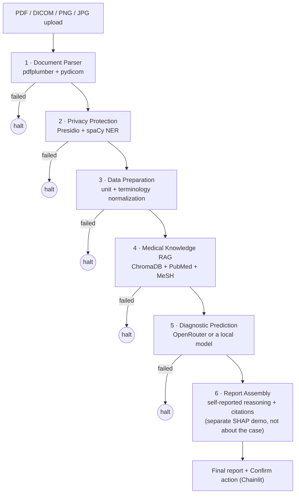

# Glassbox MD

[](https://github.com/dineshyadav03/glassbox-md)
[](https://github.com/dineshyadav03/glassbox-md/actions/workflows/ci.yml)

**An educational medical-AI project with three parts: a six-agent pipeline that turns a patient's documents into a
ranked differential diagnosis and shows every step it took, and two browser simulators of heart and brain procedures.**

> **Educational / portfolio demonstration. Not an FDA-cleared or clinically validated medical device. Not validated
> for diagnostic accuracy. Must not be used with real patient data (PHI) or to inform actual clinical decisions. All
> outputs are illustrative only, not medical advice, and require qualified clinician review before any action. The
> reasoning shown is the model's own account of itself and has not been verified as a faithful explanation of how the
> answer was reached.**
>
> This text is defined once in [`src/glassbox_md/disclaimer.py`](src/glassbox_md/disclaimer.py) and reused everywhere
> it has to appear.

## Contents

1. [What this project is](#what-this-project-is)
2. [How the diagnostic pipeline works](#how-the-diagnostic-pipeline-works)
3. [A walk-through of one case](#a-walk-through-of-one-case)
4. [The two simulators, and how they are used](#the-two-simulators-and-how-they-are-used)
5. [What "explainable" means here, and what it doesn't](#what-explainable-means-here-and-what-it-doesnt)
6. [Setup](#setup)
7. [Deployment checklist](#deployment-checklist)
8. [Known limitations](#known-limitations)
9. [Project layout](#project-layout)
10. [Testing and CI](#testing-and-ci)
11. [More documentation](#more-documentation)

## What this project is

Medical AI has a trust problem. A doctor cannot act on an answer from a black box; they need to know *why*. Glassbox
MD is a working demonstration of one way to build such a system so that its steps can be inspected, and of how
honestly its claims can be stated.

It has three parts that share one app and one login:

| Part | What it is | Where |
|---|---|---|
| **The diagnostic pipeline** | Six agents that read a lab report, history note and/or medical image, remove identifying details, standardise the data, fetch matching research papers, ask an AI model for a ranked list of possible conditions, and assemble a report with an audit trail. A clinician must click "confirm reviewed" before a case counts as reviewed. | `app.py`, `src/glassbox_md/` |
| **Cath-lab simulator** | A browser simulator of stenting a 90% blockage in a heart artery (PCI), in 3D and on a simulated X-ray screen, with a scored debrief. | [`simulator/`](simulator/README.md), served at `/cathlab/` |
| **Brain-surgery simulator** | A browser simulator of clipping a brain aneurysm under an operating microscope: ten tools, six steps with a mentor, a patient monitor, bleeding, and a scored debrief. | [`neurolab/`](neurolab/README.md), served at `/neurolab/` |

The simulators are **not connected to the diagnostic pipeline**. They read no case, write nothing, and no report links
to them: they simulate procedures with invented physiology, and a link from a patient report could be read as a
recommendation.

**Who it is for**

- *Students and educators* who want to see how an AI-assisted differential is built, and to rehearse two procedures.
- *Engineers and reviewers* who want a worked example of a multi-agent pipeline with privacy boundaries, an audit
  trail, abstention, tests and CI.
- *Researchers* interested in what "explainable" medical AI can and cannot honestly claim. The project measures and
  publishes its own weak spots (see [Known limitations](#known-limitations)).

**What it is not.** It is not a diagnostic tool, not trained or validated on real patients, and not safe to point at
real patient data. It covers six conditions (type 2 diabetes, coronary artery disease, hyperlipidemia, hypertension,
chronic kidney disease, hypothyroidism), not general medicine.

## How the diagnostic pipeline works



| # | Agent | What it does | Why it exists |
|---|---|---|---|
| 1 | **Document Parser** | Reads PDFs (text and tables), DICOM images, and PNG/JPG images, each through its own path. | Real inputs are messy and come in different shapes. |
| 2 | **Privacy Protection** | Finds and replaces names, phone numbers, IDs, dates and similar with typed placeholders; strips identifying DICOM tags; generalises ages to bands; pulls the lab values into a structured table. | Nothing that could identify a patient should travel past this point. A runtime check refuses to continue if the original file paths (which can contain a name) are still around. |
| 3 | **Data Preparation** | Converts lab values to one standard set of units, normalises terminology ("CKD" becomes "chronic kidney disease"), and flags implausible values. | The model and the literature search need consistent input. An unrecognised lab test halts cleanly instead of being guessed. |
| 4 | **Medical Knowledge RAG** | Looks up real PubMed abstracts that are indexed under the same medical concept (real MeSH IDs), falling back to similarity search outside its vocabulary. | The model's answer should sit next to checkable sources. |
| 5 | **Diagnostic Prediction** | Asks the AI model for a *ranked differential*, never a single verdict, with a likelihood and cited evidence per condition. If its confidence is below a threshold it abstains and says "insufficient evidence". | A list with honest uncertainty is safer than one confident answer. |
| 6 | **Report Assembly** | Builds the report: the differential, the model's reasoning (labelled *self-reported*), the confidence (labelled *not calibrated*), the citations (labelled *retrieved, not verified*), a flag if the top two answers are close, and the full audit trail. | The report says what each part is and is not. |

Two outcomes are kept distinct. **`failed`** means nothing usable was produced, so the pipeline stops. **`needs_review`**
(an implausible lab value, low confidence, a close call between two conditions) is not a failure: the case continues
with the flag carried into the report so a human sees it.

The case is saved only after redaction (never the raw upload), and a clinician's "Confirm reviewed" click is recorded
with a real timestamp. Past cases can be browsed and reopened from the start menu.

## A walk-through of one case

*This is an illustrative scenario with an invented patient, to show how the pieces fit. The numbers in the report
excerpt are made up for the example; they are not output from a real run.*

**The setting.** A teaching hospital runs a weekly session on appraising AI decision support. The instructor has a
synthetic case, "Mr. R", written for teaching: a 58-year-old with a fasting glucose of 9.8 mmol/L, an HbA1c of 8.4%,
LDL cholesterol of 4.6 mmol/L, a creatinine at the upper limit of normal, and a history note mentioning chest
tightness on climbing stairs and a father who had a heart attack at 55. It is a PDF with a made-up name, date of
birth and record number printed on it. (Real patient data must never go in. The project forbids it and says so on
every screen.)

**1. Upload.** The instructor starts the app (`chainlit run app.py -w`), picks "Upload a new case", and drops in the
PDF. The upload prompt states where the case will be analysed: on this machine, if a local model is configured, or via
OpenRouter.

**2. Watch the six steps.** Each agent appears as its own step as it finishes:

- *Parser*: finds one document, a lab table and a free-text history note.
- *Privacy*: reports counts per type only (for example a person name, a date and a record number, once each), never the
  values. The instructor expands the step and the class sees the placeholders where the name used to be. The age "58"
  has become the band "50-59".
- *Data Preparation*: standardises the units and recognises "T2DM" as type 2 diabetes. Nothing implausible, so no flag.
- *Medical Knowledge RAG*: returns five PubMed abstracts, each with a link, matched to diabetes and coronary disease
  by their MeSH indexing.
- *Diagnostic Prediction*: the model returns a ranked differential.
- *Report Assembly*: puts it together.

**3. Read the report.** An illustrative excerpt:

| Condition | Likelihood | Evidence (the model's own words) |
|---|---|---|
| Type 2 diabetes mellitus | high | fasting glucose 9.8 mmol/L and HbA1c 8.4% are both above diagnostic thresholds |
| Coronary artery disease | moderate | exertional chest tightness, family history, raised LDL |
| Hyperlipidemia | moderate | LDL 4.6 mmol/L |

Beneath it the class sees the things that make this a "glass box" rather than a black one: the model's confidence marked
*not calibrated*; every claim marked *self-reported*; the PubMed citations marked *retrieved, not verified*; an
"Answered by" line naming the exact model that replied; and a separate footer with a SHAP chart, labelled *not about
this case* because it explains a toy model trained on a public dataset.

**4. The teaching moment.** The instructor now asks the questions the project exists to provoke. *Does the cited paper
actually support the claim next to it?* (Nothing here checks.) *Would the answer change if the glucose were removed?*
(Not tested for the real call.) *How confident should we be?* The README's own measurement is on screen to answer that:
on real chest X-rays this kind of model was right about a third of the time and its stated confidence did not tell
which third.

**5. Sign-off.** A student playing the clinician reviews the differential, then presses **Confirm reviewed by
clinician**. The case is saved with a timestamp and shows as confirmed when reopened from "Browse past cases".

**What a real deployment would still need**, and this project does not have: validation on real patients, per-user
accounts, encryption of saved cases, a legal basis and agreements for sending any data to a model provider, and a
model that has been shown to be accurate for the conditions it is used on. The
[Deployment checklist](#deployment-checklist) lists what exists and what doesn't.

## The two simulators, and how they are used

Both are small, self-contained browser apps (Vite, TypeScript, Three.js) that the Glassbox app serves on its own
address and behind its own login. Every number in them is invented and listed in a design-notes file. Both state on the
first screen that they are educational and not clinical training.

**Cath-lab PCI simulator** ([`simulator/`](simulator/README.md))

*Scenario.* A cardiology fellow-in-training wants to rehearse the *order* of a stenting procedure before ever
standing at a table. They open `/cathlab/`, press **Watch a demo first** to see a narrated run, then take over. They
work through six scored steps on a 90% blockage of the mid left anterior descending artery, coming in through the
right wrist: advance the guide catheter, engage the left main, cross the lesion with a wire, pre-dilate with a balloon,
deploy a stent, and take a final angiogram. They switch between a 3D view and a simulated X-ray with a movable C-arm
to find a good angle, use contrast and fluoroscopy (with a running contrast total and fluoroscopy time), and watch the
patient monitor react if something goes wrong, such as a tear in the vessel wall. The debrief scores the stent's size
against the vessel, how well it covers the lesion, the narrowing left behind, the final blood flow, extra stents,
heparin and pre-dilation, and tells them what to do differently. An instructor can use the same screen to teach the
sequence to a group.

**Brain-surgery simulator** ([`neurolab/`](neurolab/README.md))

*Scenario.* A neurosurgery trainee rehearses clipping a right internal-carotid / posterior-communicating aneurysm
through the usual approach. They open `/neurolab/` and work through six steps with a mentor panel beside them:

1. Cut the thin membrane across the sylvian fissure, outer layer first, and hold the brain lobes apart.
2. Point at and identify the middle cerebral artery (M1).
3. Identify the carotid artery and the optic nerve.
4. Identify the two small neighbouring branches that a clip could harm, cut the last membrane, and free the aneurysm
   neck from the carotid, sealing small bleeding points with bipolar cautery.
5. Choose a straight or curved clip, turn it and set its depth, and apply it. A temporary clip on the carotid slows
   bleeding, but its clock runs and a long occlusion lowers the nerve-signal reading on the monitor.
6. Check the result with the Doppler (the sac should be silent and the small branch should still have flow) and with
   fluorescence (ICG) imaging.

If the trainee handles the dome roughly, it ruptures: blood pools in the field until they can no longer see, the
pressure falls, and they must suction, apply the temporary clip, and then clip. The debrief scores the clip result,
blood loss, temporary-occlusion time, injuries and more, and explains what to fix. Whether the clip closed the neck,
narrowed the carotid or pinched a branch is worked out from the clip's angle and depth against this anatomy, so
the "right answer" has to be found, not guessed.

## What "explainable" means here, and what it doesn't

The name promises a glass box. What the project delivers is narrower, and it is worth being exact about which parts
are real.

**Real and checkable.**

- *An audit trail.* Each stage records what it did, including which model answered, how many images were sent and what
  was redacted (counts only, never the values).
- *Provenance you can follow.* A runtime check stops the original upload paths from being carried past the Privacy
  stage. The retrieved literature is real PubMed records with checkable links. The "flagged for review" signal is
  computed from the model's own top-two margin and its abstention threshold.
- *Abstention.* A low-confidence answer is flagged inconclusive instead of being presented as a result.

**Not a faithful explanation.**

- *The reasoning is the model's account of itself.* A hosted closed model exposes no internals, and a fluent rationale
  is not evidence of how the answer was reached. This project's own evaluation shows why that matters: on real chest
  X-rays the model gave confident, specific, wrong rationales, and its stated confidence was no higher on correct
  answers than on incorrect ones.
- *Citations are retrieved, not verified.* Nothing checks that a paper supports the claim beside it. An optional
  second-model check can be switched on (see below); it is advisory and unmeasured.
- *The SHAP chart is not about the case.* It explains a random forest trained on a public diabetes dataset, to show the
  technique. The report says so.

**What would earn the word:** a case-level attribution from a model the project can actually inspect; perturbation
tests on the real call (remove one lab value and see whether the answer moves); and an automated check that a cited
passage supports its claim. None of these exist yet.

## Setup

**Requires Python 3.11 or newer** and Chainlit 2.x (pinned `>=2.12,<3`). CI covers Python 3.11 and 3.13.

```bash
python -m venv .venv
.venv\Scripts\activate                     # Windows (macOS/Linux: source .venv/bin/activate)
pip install -r requirements.lock.txt       # exact tested versions; or requirements.txt for newest compatible
python -m spacy download en_core_web_lg    # about 587 MB; the privacy agent needs it and fails fast without it
pip install -e .
copy .env.example .env                     # then put your API key in .env (macOS/Linux: cp)
git config core.hooksPath .githooks        # pre-commit hook that refuses to commit .env
pytest
```

Several packages (spaCy's model, ChromaDB's first embedding download, shap's native build) are slow to install.

**Build the literature index once** (fetches PubMed abstracts for the six conditions; takes a few minutes; safe to
re-run):

```bash
python scripts/build_literature_index.py
```

Without it the literature step reports `needs_review` and the rest of the pipeline still runs.

**Run the app** (opens at `http://localhost:8000`):

```bash
chainlit run app.py -w
```

Upload a lab-report/history PDF and/or imaging (a DICOM, PNG or JPG). Each agent renders as its own step.

**Choosing the model.** Either OpenRouter (the default: set `OPENROUTER_API_KEY`) or a model on your own machine so a
case never leaves it. For MedGemma 1.5 (4B) through Ollama:

```bash
ollama pull medgemma1.5:4b          # about 3.3 GB
```

then in `.env`: `LLM_BASE_URL=http://localhost:11434/v1`, `OPENROUTER_MODEL=medgemma1.5:4b`,
`LLM_TIMEOUT_SECONDS=600`. On a CPU-only laptop a case with an image takes roughly 1 to 1.5 minutes and needs about 4 GB
of free memory. MedGemma is released under Google's Health AI Developer Foundations terms; **read their Prohibited Use
Policy before anything is shipped**. This project only uses it for research and education, on synthetic data.

**Evidence check (optional, off by default).** A second small model can read each claim the diagnostic model wrote and say
whether the case text and retrieved passages support, contradict, or are silent on it (`decision_layer.py`, using
BioDecision-4B). It can add a section to the report and flag a case; it can never change the differential,
likelihoods or confidence. It needs a server that returns log-probabilities and is untested here against the real
weights. Set `DECISION_BASE_URL` to switch it on. Details: [engineering notes](docs/ENGINEERING-NOTES.md).

**Building the simulators.** They are optional and need Node 20 or newer. Without a build, the start menu says how to
build instead of leading to a dead link.

```bash
cd simulator && npm install && npm run build      # the cath lab, at /cathlab/
cd ../neurolab && npm install && npm run build    # the brain-surgery simulator, at /neurolab/
```

then restart the app and pick them from the start menu. Each can also be run on its own with `npm run dev`.

## Deployment checklist

This is a local, single-operator demo. It is **not** ready to be exposed to a network as-is.

**In the code.**

- *Bind address:* serves on `127.0.0.1` by default and **refuses to start** on any other host unless login is configured.
- *Login (opt-in):* set `GLASSBOX_AUTH_USERNAME`, a salted PBKDF2 hash from `python -m glassbox_md.auth hash` in
  `GLASSBOX_AUTH_PASSWORD_HASH` (single-quoted; it contains `$`), and `CHAINLIT_AUTH_SECRET` from
  `chainlit create-secret`. A half-configured login also refuses to start rather than silently running open.
- *Origin checks:* `origin_guard.py` rejects cross-origin browser requests, HTTP and websocket. This was needed because
  tightening Chainlit's `allow_origins` alone does not cover its websocket: a page open in the same browser could
  otherwise drive a local copy and read its saved cases.
- HTML rendering in messages is off, and user environment variables are not persisted.

**Not done, and needed before any real deployment.**

- TLS and rate limiting: put a reverse proxy in front.
- One shared credential. There are no per-user accounts and saved cases are not per-user.
- Saved cases (`data/cases/cases.db`) and uploaded files (`.files/`) sit unencrypted on disk.
- Third-party data flow: with the default OpenRouter route, redacted text **and image pixels** go to OpenRouter and
  whichever provider it picks, with no business-associate agreement. Redaction covers text and DICOM metadata, not image
  pixels. Running the model locally keeps the case on the machine.
- Free-tier limits: OpenRouter's free models allow about 50 requests a day.

## Known limitations

Each is stated plainly, because a reviewer should not have to dig for them. The long versions, with evidence, are in the
[engineering notes](docs/ENGINEERING-NOTES.md).

- **The explanation is mostly the model explaining itself**, and the SHAP chart is not about the case (see above).
- **Imaging is weak, and measured.** On 24 real chest X-rays (a seeded, class-balanced sample of a public pediatric
  dataset) the model's top answer was right 8 times (33%, 95% interval 18-53%); its confidence averaged 0.32 when
  correct and 0.37 when wrong. On 60 images, the free route and local MedGemma 1.5 were not distinguishable (58.3% vs
  61.7%, p = 0.82), and both were weak at pneumonia. One dataset, image-only input, free-tier models: a measurement,
  not clinical validation.
- **Redaction is stated per HIPAA category, not as one headline number.** Under one stated rule, 16 of 18 Safe Harbor
  categories are addressed, 7 completely, 4 only behind an explicit label, and 5 partially. Biometrics and full-face
  photos are not addressed. Plain images get no OCR, so a name printed on a screenshot survives. A measured finding
  shaped the redactor: an early version hurt the model by redacting ages and durations, and a fix was validated with
  repeated runs (see the notes).
- **Six conditions only.** The model is not gated, so it can name other conditions, but only these six have structured
  lab support and a concept-matched literature index. English only.
- **No output cap on the model call.** In one case in roughly 500 local calls, the model ran away for about 90 minutes
  before failing. Nothing bounds it yet.
- **Free-tier routing.** Expect around 70 seconds per call and a changing underlying model.
- **Case storage is one local SQLite file.** Fine for a single-user demo, not a multi-user service.
- **No formal clinical validation of any kind.** Nothing here has been checked by clinicians, and every simulator rule and
  score is an invented teaching value.

## Project layout

```
healthcare/
├── app.py                 the Chainlit app (run it with `chainlit run app.py -w`)
├── src/glassbox_md/
│   ├── pipeline.py        wires the six agents into one LangGraph graph
│   ├── state.py           the shared state, with the privacy-boundary check
│   ├── agents/            document_parser, privacy_protection (+ redaction_policy), data_preparation,
│   │                      medical_knowledge_rag (+ controlled_vocabulary), diagnostic_prediction, explainability
│   ├── case_store.py      saved cases and clinician confirmation (SQLite)
│   ├── auth.py, origin_guard.py   opt-in login, startup gate, cross-origin protection
│   ├── report_format.py, disclaimer.py, audit.py, image_io.py
│   ├── decision_layer.py  optional advisory evidence check
│   ├── imaging_eval.py, imaging_compare.py, text_eval.py      the project's own evaluations
│   └── labs.py, cathlab.py, neurolab.py     serve the two simulators inside this app
├── simulator/             the cath-lab PCI simulator (Vite + TypeScript)
├── neurolab/              the brain-surgery simulator (Vite + TypeScript)
├── scripts/               build the literature index; run the evaluations
├── data/                  local data folders (synthetic or public data only; see data/README.md)
├── docs/                  engineering notes, evaluation reports, reference images
├── tests/                 the Python test suite
└── .github/               CI, weekly dependency audit, Dependabot
```

## Testing and CI

- **Python:** an offline suite of several hundred tests (`pytest`) covers every agent, the full graph end to end,
  14 diverse synthetic cases, and a sweep that confirms planted identifiers do not survive anywhere past the Privacy
  agent. It needs no API key and makes no model call. Two things it cannot check: a live model call and the UI in a real
  browser; both were checked by hand and are described in the notes.
- **Simulators:** each has its own typecheck, unit tests and production build (`npm test`, `npm run build`). Their
  rules are pure functions, so a scripted learner can play a whole case in a test.
- **CI** (GitHub Actions) runs the Python suite on 3.11 and 3.13 against both the requirements file and the exact-pin
  lock file, builds both simulators on two Node versions, and fails if the lock file drifts from `requirements.txt`. A
  weekly job audits the Python and npm dependencies.

## More documentation

- [`docs/ENGINEERING-NOTES.md`](docs/ENGINEERING-NOTES.md): the full build history and design decisions, with the bugs
  found, what was measured, and which claims were corrected.
- [`docs/imaging-comparison.md`](docs/imaging-comparison.md), [`docs/imaging-eval-results.md`](docs/imaging-eval-results.md),
  and the `text-eval-*` reports: the evaluation results behind the limitations above.
- [`simulator/README.md`](simulator/README.md) and [`neurolab/README.md`](neurolab/README.md), with each one's
  `DESIGN-NOTES.md` listing every invented number.
- [`CONTRIBUTING.md`](CONTRIBUTING.md).

**Papers this design draws on.** Neither is implemented here, only drawn on:
Sun, Akman and Schuller, *Explainable Artificial Intelligence for Medical Applications: A Review*
([arXiv:2412.01829](https://arxiv.org/abs/2412.01829), 2024), which shaped the audit-trail and clinician-confirmation
design; and Wu et al., *Medical Graph RAG* ([arXiv:2408.04187](https://arxiv.org/abs/2408.04187), 2024), whose idea of
tying a record to literature through a controlled vocabulary is what the literature step borrows, in a much smaller
form (PubMed's MeSH indexing in ChromaDB, not the paper's three-tier graph).

## License

GPL-3.0. See [`LICENSE`](LICENSE).
