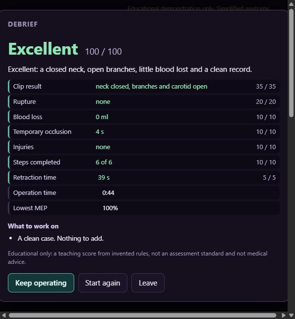
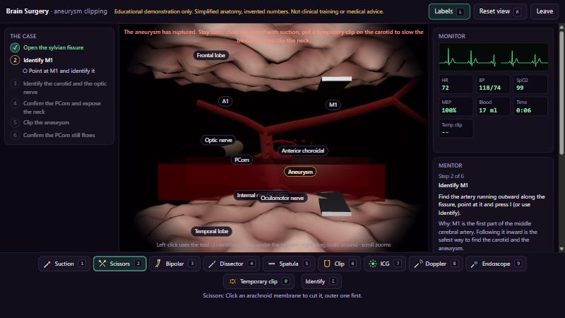

# Brain Surgery Simulator (educational)

A browser simulator of microsurgical clipping of a right internal carotid to posterior communicating artery (IC-PC)
aneurysm through a pterional, transsylvian approach, seen through an operating microscope.

**Educational only. It is not clinical training, not a medical device and not medical advice. The anatomy is
simplified, procedural 3D shapes and every number is invented** (see [DESIGN-NOTES.md](DESIGN-NOTES.md)). It is not
connected to the Glassbox MD diagnostic pipeline or to any case.

## Status: complete (milestones M0 to M6)

Done: the operating-microscope view of the field (folded lobes, the sylvian fissure that opens and closes, ICA, M1 and
M2, A1, PCom, anterior choroidal artery, optic and oculomotor nerves, the 6.6 mm aneurysm with its bleb, the two
retractor blades, arachnoid membrane in cuttable segments), pulsing arteries, labels, zoom, pan and a limited orbit.

Also done (M2): the ten tools, each with its own rule and cursor: suction, scissors, bipolar, dissector, spatula, clip
(straight or curved, turned and set to a blade depth), ICG, Doppler, endoscope and temporary clip. Cutting the membrane
outer-first lets the spatula open the fissure; the dissector then frees the aneurysm neck; the clip goes on a freed neck.
A readout shows the membrane, fissure, neck, dome strain, bleeding points, temporary-clip clock, clip and injuries.

Also done (M3): the six steps (open the sylvian fissure; identify M1; identify the carotid and optic nerve; confirm the
PCom and expose the neck; clip; confirm the PCom still flows), each with sub-tasks that tick off, locked until the one
before is finished. A mentor panel gives a calm next-step hint and why the step matters, and comments when a step is
done, when something goes wrong, and when the temporary clip or the retraction has gone on too long. To identify a
structure, point at it and press `I` (or click Identify, then the structure). The checks in step 6 only count after the
clip is on.

Also done (M4): a patient monitor (ECG, heart rate, blood pressure, SpO2, motor evoked potentials, blood loss, time, temporary-clip
clock) that reacts to what you do. Bleeding pools in the field and hides it until you suction; a rupture needs suction, a
temporary clip and then the clip. A long temporary occlusion lowers the MEP.

Also done (M5): the clip is judged. Depth and angle decide whether the neck closes, whether the carotid is narrowed and
whether the PCom or the anterior choroidal artery is pinched, and ICG and the Doppler show it: a good clip darkens the sac
and leaves the arteries glowing; a bad one does not. Hold the Doppler on a vessel with flow to hear one whoosh a heartbeat.

Also done (M6): a debrief that scores the case (clip result, rupture, blood loss, temporary occlusion, injuries, steps,
retraction time) with an Excellent / Good / Fair / Needs work grade and tips; a narrated demo that performs the whole case
and ends on an Excellent debrief (press any key or click to take over). It is English only. The plan is in [PLAN.md](PLAN.md).

| The debrief after the demo | A rupture: pool, jet and monitor |
|---|---|
|  |  |

## Run it

Needs Node 20 or newer.

```bash
cd neurolab
npm install
npm run dev        # http://localhost:5173/neurolab/
npm test           # unit tests
npm run build      # production build into dist/, which the Glassbox app serves at /neurolab/
```

Inside the Glassbox app: build it once, restart the app, and pick "Brain surgery simulator" in the start menu.

Press **Watch a demo first** on the start screen to see the whole case performed with narration (speed 1×, 2× or 4×).

Keys: `1` to `9` and `0` pick the tools (suction, scissors, bipolar, dissector, spatula, clip, ICG, Doppler, endoscope,
temporary clip), `I` identifies what is under the pointer, `N` toggles sound. With the clip: `A` and `D` turn it, `W` and `S` set blade depth, `V` swaps straight and curved, and
Backspace removes it. `L` labels, `R` resets the view. Left-click uses the tool; right-drag looks around, scroll zooms,
and the arrow keys or middle-drag move.

## Changing the anatomy

Every size and position is in `src/config/anatomy.ts`. For example, `aneurysm.domeDiameterMm: 6.6` makes the dome
10 mm wide if you change it to `10`.
