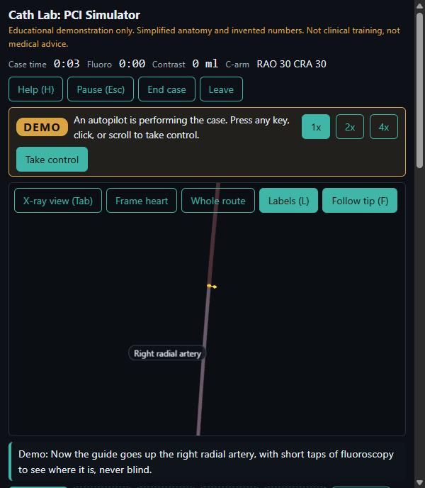
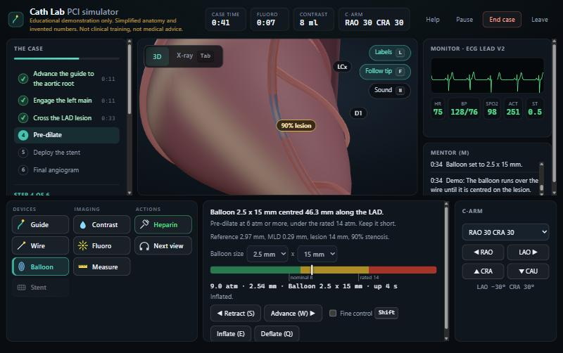
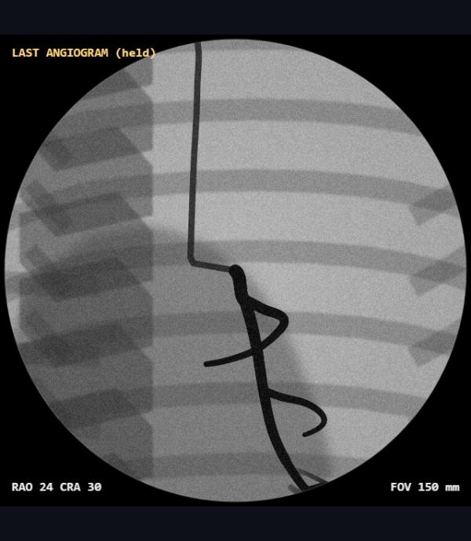
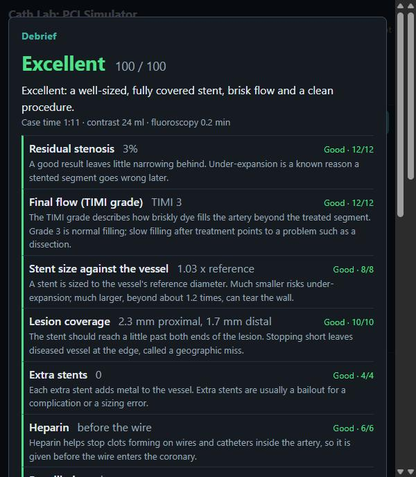

# Cath Lab: PCI Simulator (educational)

> **Educational demonstration only.** This is a coding project and a teaching demo. It is **not clinical training and
> not medical advice**. Its anatomy, physiology, device rules and scoring are simplified models with invented numbers,
> and it must not be used to make or inform any clinical decision. No real patient data is used or accepted. Keep this
> disclaimer on the start screen if you share or modify it.

A browser-based simulator of percutaneous coronary intervention (PCI): stenting a 90% mid-LAD stenosis through the
right radial artery, in six scored steps, in 3D and on a simulated X-ray screen, with a narrated demo that plays the
whole case. Strict TypeScript, Three.js, Vite and Vitest; every rule is a pure function with a unit test.

| The demo playing the case | A balloon across the lesion |
|---|---|
|  |  |
| **The X-ray view: the held angiogram** | **The scored debrief** |
|  |  |

There is no public live link: it has not been deployed (see [Deploying](#deploying)). To run it:

```bash
cd simulator && npm install && npm run dev      # then open http://localhost:5173/cathlab/
```

Needs Node 20 or newer. Press **Enter the cath lab** to play, or **Watch a demo first** to see it done.

## Where it lives

It is part of the Glassbox MD app: the app serves the built simulator at `/cathlab/` on its own server
(`src/glassbox_md/cathlab.py`), behind the same login when login is configured, and offers it from the start
menu. It is **not connected to the diagnostic pipeline**: the pipeline reasons about real-shaped documents,
this simulates a procedure with made-up physiology, so it reads no case and no patient report links to it;
mixing the two would blur what each one claims.

Built with Claude Code in Vite, strict TypeScript, Three.js and Vitest, with the rules in pure functions and every
constant in one config file (1 scene unit = 1 mm).

**What is this project's own work.**

- **A case you can prove is finishable.** The procedure engine is a pure `tick`/`act` pair, and a scripted learner plays
  all six steps through it in a test and must score Excellent, so a rule that made the case impossible fails the build.
- **A demo that is an input source, not a trick.** The autopilot answers each moment with the same held controls and
  button presses a person produces, and its result is checked at three frame rates.
- **An X-ray screen driven by the same model as the 3D view,** so foreshortening, the lesion's pinch, a tear's filling
  defect and stent struts come from geometry, not artwork; a second final view must differ by 20 degrees to count.
- **Honest numbers.** Every invented constant and judgment call is written down in [`DESIGN-NOTES.md`](DESIGN-NOTES.md), and
  the debrief's thresholds are labelled teaching choices, not standards.
- **Served from inside the Glassbox app,** behind its login, with a test that serves the real build and every file it
  loads, so a wrong path cannot ship as a blank page.

## Run it

Inside Glassbox MD (the normal way): build once, then start the app and use the start menu.

```bash
cd simulator
npm install
npm run build      # typecheck + production build into simulator/dist
cd ..
chainlit run app.py -w     # then http://localhost:8000/cathlab/
```

While working on the simulator itself:

```bash
cd simulator
npm run dev        # hot reload at http://localhost:5173/cathlab/
npm test           # unit tests
npm run typecheck  # strict TypeScript, no emit
```

The build is for the path `/cathlab/` (`base` in `vite.config.ts`); a Python test checks it matches the
server, and another serves the real build and loads every file it references.

## Tests

- **552 unit tests in 26 files** (`npm test`, count at the time of writing), all passing: the lesion and lumen, flow and TIMI, devices, physiology
  and ECG, the guide and the wire, the stages and tool unlocks, the scored debrief, the 3D geometry and scene, the
  X-ray projection and image content, the HUD model and input mapping, hover measurement, the sound cues (with a fake
  audio context), and the demo autopilot.
- **End to end at the logic level:** a scripted learner (`tests/helpers/player.ts`) plays the whole case through the
  real engine and must score Excellent; the demo autopilot must do the same at three different frame lengths; the
  specification's deliberately bad case (an oversized stent at high pressure) must give a dissection, reduced flow and
  a "Needs work" debrief.
- **In Python** (`tests/test_cathlab.py`, `tests/test_cathlab_real_build.py`): the app mounts the simulator ahead of
  Chainlit's catch-all, gates it behind the login, blocks path traversal, and serves the real build, including the
  lab chunk that loads when someone enters.
- **Not covered by tests:** what the 3D and X-ray views look like, and how they feel on a real GPU. Those were checked
  by playing in a browser (see `DESIGN-NOTES.md` for exactly what was and was not).
- CI (`.github/workflows/ci.yml`) typechecks, tests and builds on Node 20 and 22, and also builds the simulator inside
  the Python test job; a weekly audit job checks the npm dependencies.

## Status

| Phase | What | State |
|---|---|---|
| 0 | Scaffold, strict TypeScript, tests, disclaimer start screen | done |
| 1 | Pure logic: flow and TIMI, devices, physiology, guide and wire, stages, debrief | done |
| 2 | Procedural heart and vessels, 3D view | done: beating heart, six coronaries at true lumen, aorta, wrist-to-root route, labels, orbit camera |
| 3 | Devices and the six-stage procedure UI | done: playable end to end with a scored debrief (see below for what is simplified) |
| 4 | X-ray view and C-arm | done: live fluoroscopy, last-image hold, contrast cine and a movable C-arm |
| 5 | Demo autopilot and complications | done: narrated demo that ends on an Excellent debrief; tear staining on fluoro |
| 6 | README polish, CI, deploy decision | done: see Tests and Deploying |

**What you can do today:** the whole case is playable in the browser. Press "Enter the cath lab" and work through
the six steps: advance the guide from the wrist to the aortic root, seat it in the left main, take a diagnostic
angiogram, give heparin, steer the wire into the LAD and across the lesion without forcing it, pre-dilate with a
balloon, size and deploy a stent, and finish with an angiogram from two projections. You then get a scored debrief
that explains each item. The screen has the step checklist with a "Why this step?" note, a tool bar that locks tools
until their step (saying why), a tip-rotation dial with the target angles, a pressure gauge with the balloon's rated
and rupture pressures, a patient monitor with a live ECG, and a mentor log. Keys: `1`-`4` tools, `W`/`S` or the wheel
advance and retract, `A`/`D` rotate, `Shift` fine, `E`/`Q` inflate and deflate, `G` heparin, `C` or `5` contrast,
`7` measure, `Space` or `6` fluoro pedal, `V` C-arm, `L` labels, `F` follow, `H` help, `M` mentor, `Esc` pause.
On a touch screen the on-screen buttons can be held instead.

**The X-ray view** (`Tab`): a fluoroscopy screen showing a simplified, flat shadow of the case from the C-arm's
angle: ribs, spine, arm bones and the heart's beating shadow. Catheters, the wire, balloon markers and stent struts
appear only while the pedal is down; with the pedal up the last image is held. Contrast shows as a dark column the
width of the real lumen, so the 90% lesion is a pinch, a stent opens it, and a tear leaves a filling defect. Each
contrast run is acquired as a cine, and its best-filled frame is held as the angiogram. The C-arm has presets (`V`),
arrow-key nudging (1 degree, Shift 5), and a panel; a second final angiogram counts only if its beam differs from the
first by at least 20 degrees. The field of view follows the tip (wide for the arm, tight on the arteries).

**The demo** ("Watch a demo first" on the start screen): an autopilot performs the whole case through the same
engine, controls and buttons a learner uses, narrating each step in the mentor log under a DEMO badge, at 1x, 2x or 4x.
It turns the guide to the left cusp, takes it up the arm with short fluoro taps, seats it, takes an angiogram, gives
heparin, measures, steers the wire into the LAD and across the lesion slowly, runs a 2.5 x 15 balloon at 10 atm for about
12 s, then a 3.0 x 18 stent at 12 atm, and finishes with angiograms from two projections. Any key, click or scroll hands
control back. It ends on an Excellent (100) debrief, which the tests check at any frame rate.

**Complications:** a wire forced through the lesion, or a balloon or stent over 1.2 times the vessel, tears the wall
(a stent tears just beyond its end). A tear shows as a dark flap in 3D and, on fluoro, as a filling defect plus contrast
staining beside the lumen that lingers while the dye washes out; it slows flow until a stent covers it. A balloon taken
4 atm past its rated pressure bursts and may tear the wall. A long inflation makes the patient ischaemic and then
unstable. An oversized stent at high pressure gives a dissection, reduced flow and a "Needs work" debrief.

**Measuring** (`7`): takes the QCA reading (reference diameter, minimum lumen diameter, lesion length, % stenosis) from the
angiogram, and switches on a hover read-out in the 3D view: point at an artery and it names the vessel, how far along it
you are, the lumen there against the healthy width, and the % stenosis, including through the pinch of the lesion. Measuring
again after a balloon or stent reads the result. Press `7` again to switch the hover off.

**Sound** (`N`, off until you press it): a monitor beep at the patient's heart rate whose pitch falls as oxygen saturation
falls, a repeating alarm while the patient is unstable, a chime when a step is completed, and short tones for good,
warning and danger messages (a refused action, a tear, a rupture). It is synthesised in the browser, so there are no audio
files.

Each tool has its own cursor and a tooltip with its rule (or, when it is locked, why).

**Everything in the specification is now built.** What remains are simplifications, which the start screen and help panel
state: the X-ray picture is a flat sketch of a stylised anatomy, and contrast also shows on the 3D vessels as a teaching aid.

## How the 3D part is organised

- `src/anatomy/` is pure maths with no Three.js: vectors, splines, the heart surface, the centrelines of every
  vessel and the access route, tube meshes, label data. All of it is unit tested.
- `src/scene/anatomyScene.ts` builds the Three.js scene from that, and can be built and checked in node.
- `src/engine/simulation.ts` is the procedure engine: pure `tick` and `act` functions that step the guide, wire,
  balloon and stent catheters, the patient and the stage progress together. A scripted learner
  (`tests/helpers/player.ts`) plays the whole case through it, so the stage rules are proven completable.
- `src/scene/devices.ts` draws the devices, dissection flaps and contrast from a `Simulation`; headless-safe.
- `src/ui/hudModel.ts` computes everything each panel shows (tested); `hud.ts`, `gauges.ts`, `monitor.ts` and
  `debriefScreen.ts` only place it in the DOM; `input.ts` maps keys, on-screen holds and the wheel to controls.
- `src/audio/` is the sound: `cues.ts` decides when (pure, tested) and `sound.ts` synthesises the tones through an audio
  context that tests replace with a fake. `src/scene/measure.ts` turns a point on an artery into a diameter read-out.
- `src/demo/autopilot.ts` is the demo: a pure state machine whose `advanceDemo` is used by both the screen and the tests.
- `src/xray/` is the X-ray view: `projection.ts` (C-arm geometry), `frame.ts` (what the image contains, as shapes; tested)
  and `display.ts` (the canvas: noise, collimator, last-image hold, angiogram capture).
- `src/scene/viewer.ts`, `src/xray/display.ts` and `src/ui/labScreen.ts` are the only code that touches WebGL, canvases,
  frames and browser events. They are checked by playing in a browser, not by unit tests.
- Each vessel's 3D path is cut or extended to exactly its configured length, so what the rules say (distance along
  a rail) and what is drawn cannot drift apart.

## Deploying

**The decision: it is not deployed, and the supported way to run it is inside the Glassbox app.** Putting it on a public
URL publishes it to anyone, which is a choice for its owner to make, and the app already gives it one origin, the same
login and the same disclaimers. If you do want a standalone link (the specification's stretch goal), the build is ready:

```bash
cd simulator
npm run build:standalone     # same sources, base "/" instead of "/cathlab/", into simulator/dist-standalone
```

Point any static host at `simulator/dist-standalone` (for Vercel: root directory `simulator`, build command
`npm run build:standalone`, output directory `dist-standalone`). Keep the start-screen disclaimer, and note that the
standalone build is not behind the Glassbox login. CI builds it on every change so the script cannot rot.

## What I would do differently

The numbers are invented teaching choices, so I would have a clinician review and calibrate the flow, pressure, timing and
scoring constants before calling it anything more than a demo. The 3D and X-ray views were verified by looking, which
found real bugs (opaque arteries hiding the devices, the mouse wheel hijacking page scrolling) that no unit test could
have; I would add screenshot-based regression tests with a real browser, and test the frame rate on a real GPU. The
X-ray picture is a flat sketch of a stylised anatomy, so I would replace it with a proper projection of a volume model
with a diverging beam, and give the sound a listening test with real people, which I could not do.
